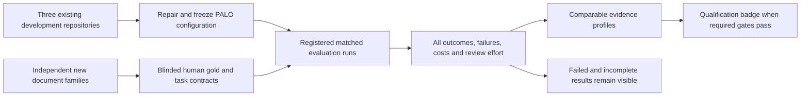

# PALO BlueprintBench proposal package

Status: **research and design proposal**, 10 November 2026. No held-out leaderboard is qualified or published by this package. The three current Workbench repositories are development/regression cases.

* [PROPOSAL.md](proposal.md): evaluated unit, tracks, new-case design, eight dimensions, metric denominators, human review, FinOps, statistics, eligibility and delivery sequence.
* [RESEARCH.md](research.md): comparison of 14 primary-source benchmark/leaderboard references, including direct document and process-model comparators; three verified candidate source pools.
* [REVIEW-DECISIONS.md](review-decisions.md): external model consultation record, accepted criticisms and rejected overclaims.
* [LOCAL-REVIEW.md](local-review.md): completed LM Studio review, model-identity limits and earlier failed attempts.
* [RUN-RECORD-FIELDS.json](run-record-fields.json): proposed evidence fields and invariants. This is not an executable validator.
* [catalogue-development-status.json](catalogue-development-status.json): ten existing diagnostic model entries, with source hash, all explicitly unranked and ineligible for held-out ranking. The historical configurations are preserved, not endorsed as optimal settings.

The proposed practical first step is six new repository families in three domains, followed by a 12-family/six-domain feasibility programme if measurement quality and resources support it. A scale stratum contains naturally coherent repositories of at least 100 MB. Neither repository count nor byte size automatically establishes statistical credibility.

The proposal is advisory. GLM, Gemini and a local model are design reviewers, not certifiers, human annotators or independent replications of the Workbench experiments. PALO product qualification remains a separate engineering task.
